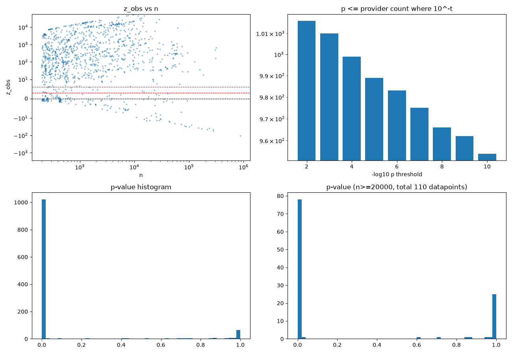
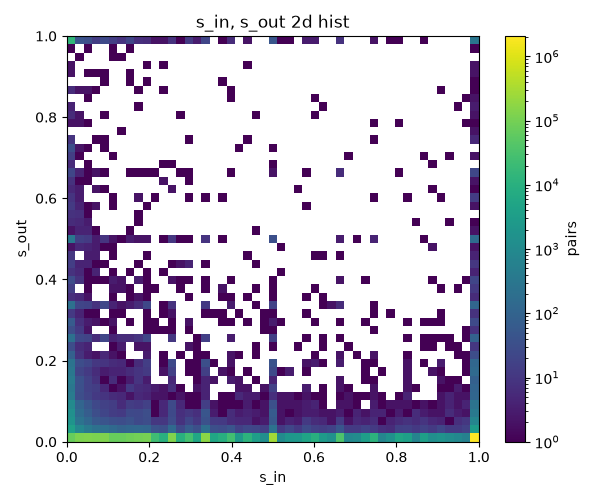
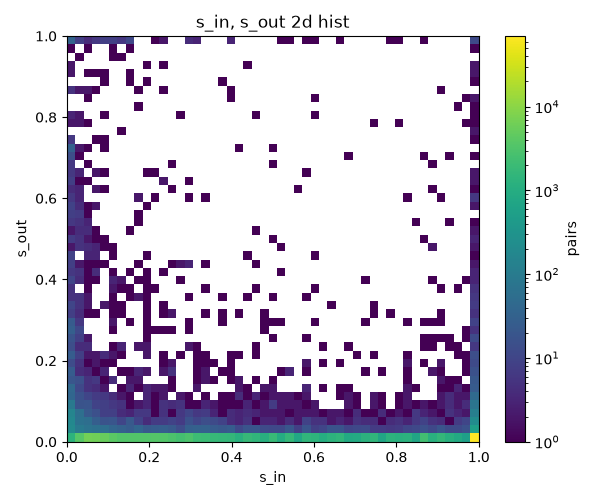

# tron_graph_optim_RDH

## Resource-Delegation Heuristic
Developed by ReenAG, will be published in paper soon.

## Code-of-Conduct
1. test, plot codes are generated by claude code, opus 5.5.
2. code-review was conducted by claude code, opus 5.5.
    - Therefore, AI auto-generated codes are included.

## Installation
```bash
pip install "git+https://github.com/heeboy007/tron_graph_optim_RDH"          # rdh only (numpy, pandas, scipy, pyarrow)
pip install "tron-graph-optim-rdh[db] @ git+https://github.com/heeboy007/tron_graph_optim_RDH"  # + DuckDB loader / CLI
```
Requires Python >= 3.13. Analysis scripts under `rdh_data_adapter/analysis` are not part of the package.

## Usage
```python
from rdh import RDHParams, component_map_from_events, condense_edges
cmap = component_map_from_events(src, dst, amt, bn, is_d, start, end, RDHParams(tau=0.05))  # sorted ENERGY delegate(1)/undelegate(-1) events incl. 14-day warm-up/horizon
u_src, u_dst, weight_sum, n_internal = condense_edges(usdt_src, usdt_dst, cmap, weight=usdt_amount)  # USDT edges on component representatives
```
- `component_map_from_graph(graph, start, end, params)`: same, from an already loaded/paired `ResourceGraph`.
- `rdh.save_as_pq(path, cmap)` / `rdh.load_from_pq(path)`: parquet (address map, merged pairs) + `meta.json` (params, window, summary, version, git commit).
- With `[db]`: `rdh_data_adapter.helper.build_component_map(start, end, params, db_path=None)` reads `tron.db` (`RDH_DUCKDB_DIR` if `db_path` is omitted), or
  `python -m rdh_data_adapter component-map --start 80000000 --end 80200000 --out path [--tau 0.05 --mu0 0.61 --A 5 ...]` (`--mu0 none` disables the mu condition).

`ComponentMap` holds one row per address in a component of size ≥ 2: `addr`, `rep` (smallest address in the component), `comp_id` (0.., ordered by `rep`), `comp_size`.

## Tron resource graph analysis

### z and p-value credibility check

Very high concentration of p-value near 0 is detected. 
This usually means null model was not really suitable, rendering most of the p-value using method useless.
Legacy pipline plots are documented [here](docs/legacy.md).

### Effect-size merge rule (current thresholds)
Developing effect-size based method for RDH was needed.
A pair (provider $P$, receiver $r$) is merged when all of the following hold:
1. $\text{active}_{P,r} > A$
2. $\mu_P < \mu_0$, or $\mu_P$ is undefined (NaN)
3. $e_{P,r} = \min(s_{in}, s_{out}) > \tau$

where $s_{out} = n_{pair} / n_P$, $s_{in} = n_{pair} / n_{in}$, and $\text{active}$ is the number of distinct 1-hour buckets with a delegation of that pair.

| symbol | value | meaning | code |
|---|---|---|---|
| window | blocks 80,000,000 ~ 80,200,000 | ENERGY `delegate` events only | `rdh_data_adapter/load/resource_graph.py` |
| warm-up / horizon | 403,200 blocks (14 days) each side | R1 FIFO pairing of delegate/undelegate on (src, dst, amount) | `rdh/pipeline/effect/pair_delegate_undelegate.py` |
| bucket | 1,200 blocks (1 hour) | unit of `active` | `rdh/models/effect/coverage.py` |
| $A$ | 5 | minimum active buckets (`active > A`) | `rdh/models/effect/merge.py` |
| $\tau$ | 0.05 | minimum mutual share $e$ ($\tau \ge 1$ requires $e = 1$) | `rdh/models/effect/merge.py` |
| $\mu_0$ | 0.61 | Otsu threshold of $\mu_P$; providers with $\mu_P \ge \mu_0$ are not merged | `rdh/models/effect/merge.py` |
| `flash_max` | 100 blocks (5 min) | delegations shorter than this are *flash* ($\varphi_P$) | `rdh/models/effect/menu_ratio.py` |
| `rho` | 0.05 | relative width of log bins for durations | `rdh/models/effect/menu_ratio.py` |
| `k` | 3 | top-$k$ bins (each with ±1 neighbour) form the provider's own menu | `rdh/models/effect/menu_ratio.py` |
| `min_n` | 50 | $\mu_P$ is NaN when non-flash paired delegations $m_P$ < `min_n` | `rdh/models/effect/menu_ratio.py` |

With $A=5$, $\mu_0=0.61$, $\tau=0.05$: 1,125 merged pairs, 287 components of size ≥ 2, largest component 70 nodes, max out/in degree 10 / 8
(sensitivity over $\tau \in [0.001, 0.8]$, $A \in \{3, 5, 10\}$, $\mu_0 \in [0.3, 0.7]$: `rdh_data_adapter/analysis/rdh_effect_size_sensitivity.py`, `rdh_data_adapter/analysis/rdh_effect_size_low_tau.py`).

#### $s_{in}$, $s_{out}$ 2d histogram

Without filtering activity windows(coverage): \


With filtering activity windows(coverage): \


