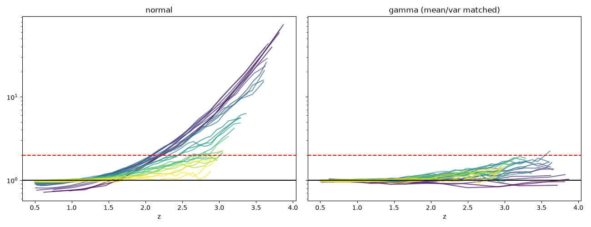
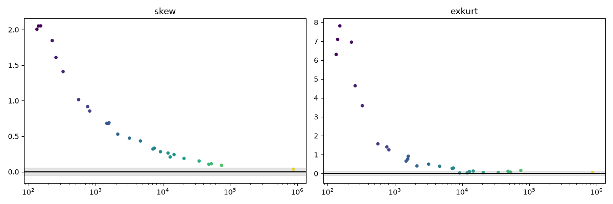
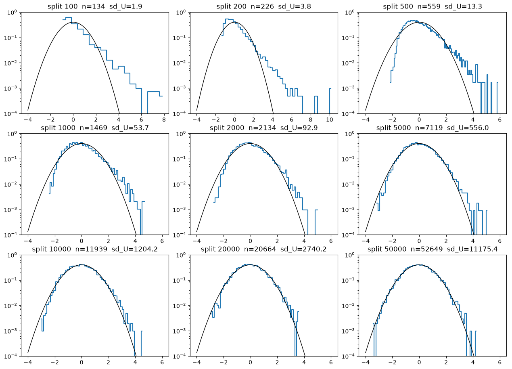

# legacy p-value BH-FDR pipeline

#### gamma distribution is more suitable for null model

Distibution of $U$
1. $U = \text{sum of } A_{ij}$ 
2. $A_{ij} = \text{1 if (event i recipient) = (event j recipient) else 0}$

#### skewness and kurtosis

#### comparision with normal distribution with different transaction counts
